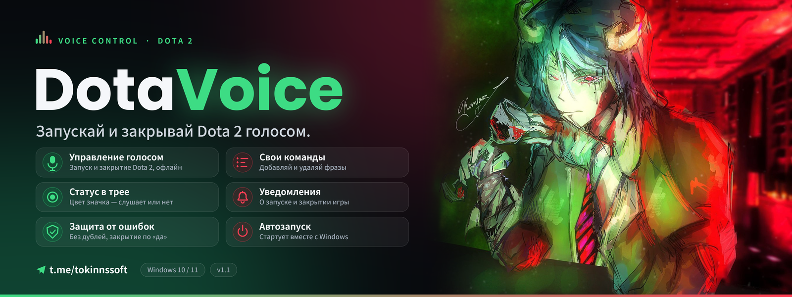

<p align="center">
  
</p>

# DotaVoice

Голосовое управление Dota 2 для Windows. Говоришь фразу в микрофон, и игра запускается или закрывается.

## Возможности

- Запуск и закрытие Dota 2 голосом: «пошли в доту», «запусти доту», «закрой доту» и другие
- Офлайн-распознавание речи через [Vosk](https://alphacephei.com/vosk/), интернет не нужен
- Свои команды: фразы добавляются и удаляются прямо в окне программы
- Защита от дублей: если игра уже запущена, повторно не откроется
- Закрытие с подтверждением: после команды нужно сказать «да», чтобы не вылететь из катки по ошибке
- Значок в трее с цветным статусом (слушает, загрузка, остановлено, ошибка)
- Уведомления Windows о запуске и закрытии игры
- Автозапуск вместе с Windows, сворачивание в трей

## Установка

1. Скачай `DotaVoice.exe` из раздела [Releases](../../releases)
2. Запусти и нажми «Начать слушать»

Требования: Windows 10/11, Steam с установленной Dota 2, микрофон.

> Антивирусы иногда ругаются на exe, собранные PyInstaller. Это ложное срабатывание, исходный код открыт, можно собрать самостоятельно.

## Команды по умолчанию

| Действие | Фразы |
|---|---|
| Запуск | «пошли в доту», «запусти доту», «запускай доту», «погнали в доту», «поехали в доту», «включи доту» |
| Закрытие | «закрой доту», «закрывай доту», «выключи доту», «выруби доту» |
| Подтверждение закрытия | «да» (в течение 8 секунд) |

Свои фразы добавляются на вкладках «Запуск Dota» и «Закрытие Dota». Если команды срабатывают слишком часто или не срабатывают, измени ползунок «Строгость распознавания». Настройки хранятся в `%USERPROFILE%\.dotavoice\config.json`.

## Сборка из исходников

1. Установи Python 3.10+ (с галочкой «Add to PATH»)
2. Скачай модель [`vosk-model-small-ru-0.22`](https://alphacephei.com/vosk/models) и распакуй её рядом со скриптом, чтобы существовал путь `vosk-model-small-ru-0.22\am`
3. Запусти `build_exe.bat`. Готовый файл появится в `dist\DotaVoice.exe`

Запуск без сборки:

```
pip install -r requirements.txt
python dota_voice_app.py
```

## Важно

Закрытие игры по команде во время матча засчитывается как выход из игры, возможны штрафы. Подтверждение голосом лучше не отключать.

## Автор

Telegram: https://t.me/tokinnssoft

## Лицензия

MIT, см. файл [LICENSE](LICENSE). Распознавание речи: Vosk (Apache 2.0).
